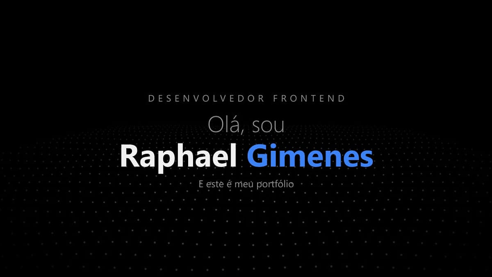
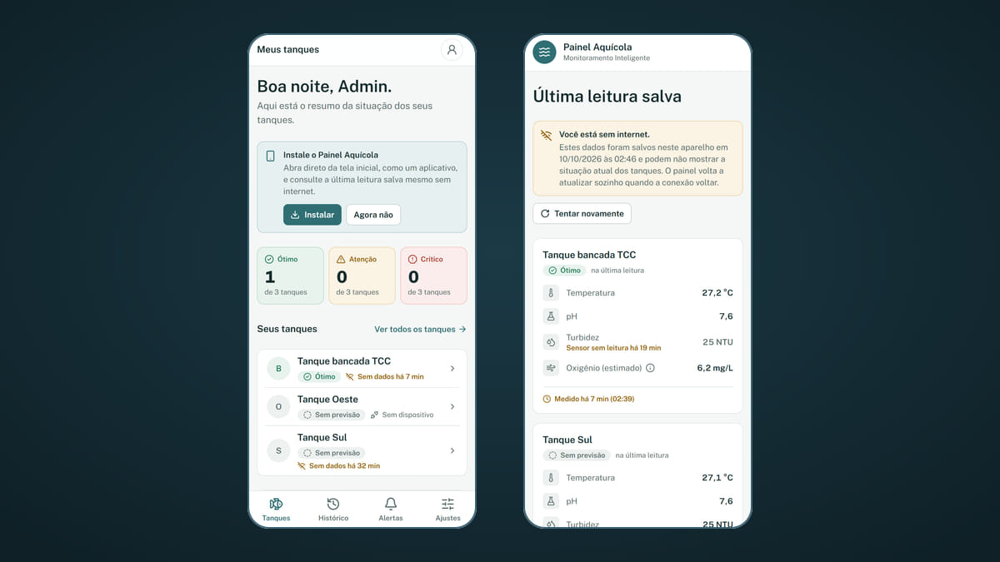
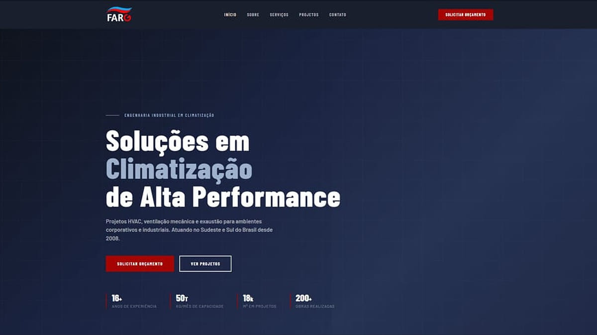
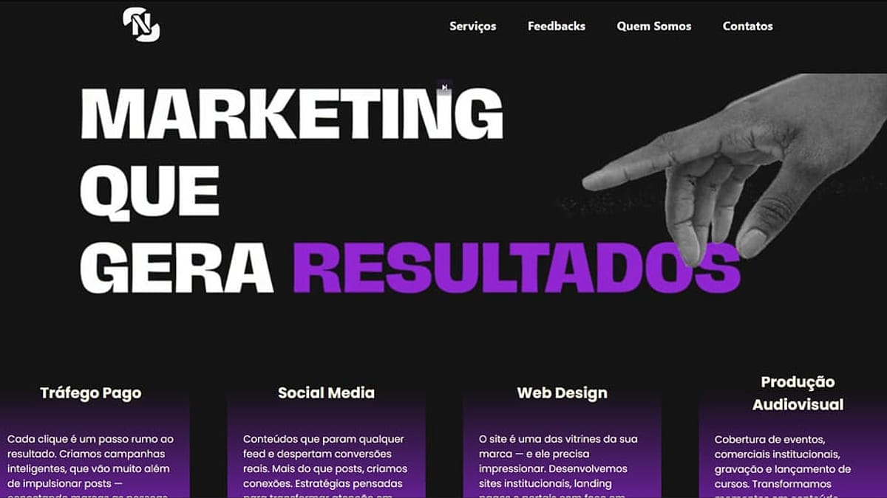
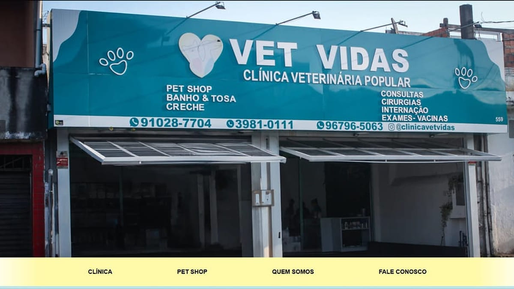

<!-- HEADER -->

  

  

## 👋 Sobre mim

Sou o **Raphael**, estudante de **Ciência da Computação na UNIP** e desenvolvedor front-end em São Paulo.
Crio sites e interfaces para empresas e clientes reais, sempre buscando o equilíbrio entre **design, performance e usabilidade**.

**Interesses:** desenvolvimento web · UX/UI · IoT · APIs

### Quer ver meu trabalho de perto? Conheça meu portfólio 👇

  
   
  

## 🚀 Projetos

<table>
  <tr>
    <td width="50%" align="center">
      
       <b><a href="https://github.com/Patokaz/front-end-tcc">Painel Aquícola</a></b> · TCC
       React · TypeScript · FastAPI · IoT
    </td>
    <td width="50%" align="center">
      
       <b><a href="https://github.com/Patokaz/farg-project">FARG Ar-Condicionado</a></b>
       Vue 3 · Vite · <a href="https://fargarcondicionado.com">no ar</a>
    </td>
  </tr>
  <tr>
    <td width="50%" align="center">
      
       <b><a href="https://github.com/Patokaz/site-noff">NOFF Marketing</a></b>
       Next.js · TypeScript · Tailwind
    </td>
    <td width="50%" align="center">
      
       <b><a href="https://github.com/Patokaz/VetVida">Clínica Vet Vidas</a></b>
       HTML · CSS · JavaScript · <a href="https://clinicapopularvetvidas.com.br">no ar</a>
    </td>
  </tr>
</table>

Mais da faculdade: <a href="https://github.com/Patokaz/api-pedidos">API de Pedidos</a> (FastAPI + Docker) · <a href="https://github.com/Patokaz/Lema-do-Bombeamento">Lema do Bombeamento</a> (Python)

## 🎓 Formação

**Bacharelado em Ciência da Computação** · Universidade Paulista (UNIP) · em andamento (TCC em 2026)

## 🧰 Tecnologias

**Uso no dia a dia**

**Também já trabalhei com**

&nbsp;+ Shopify (e-commerce headless)

## 📫 Contato

  
  
  

<!-- FOOTER -->

  

